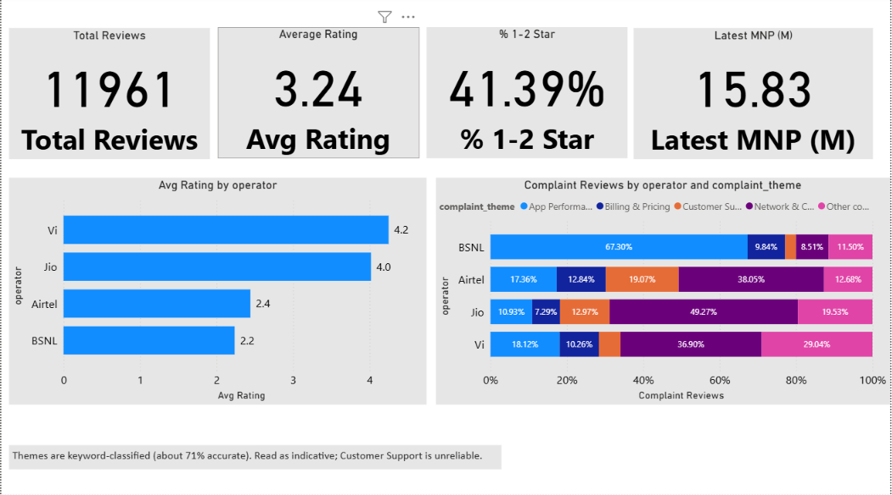
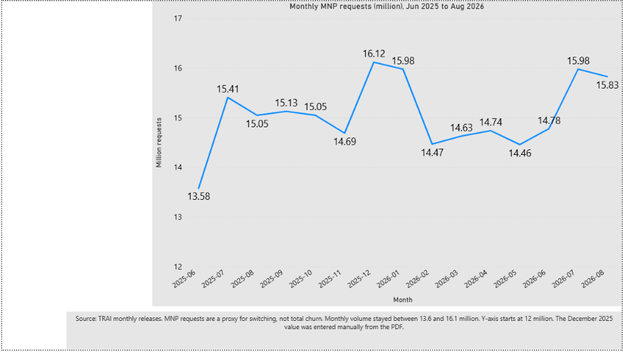
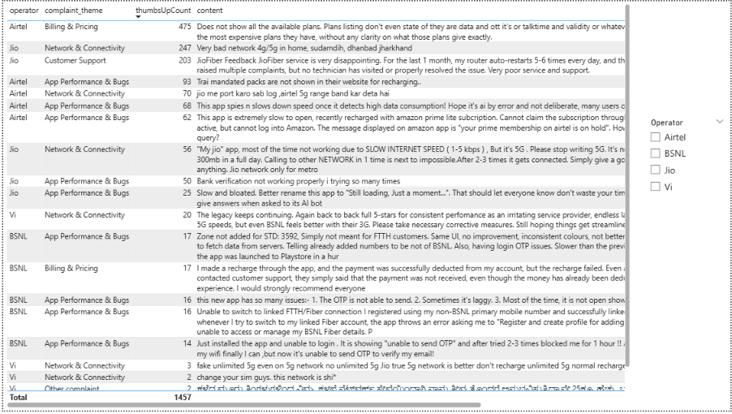

# Why Are Indian Mobile Subscribers Switching Operators?

**Question:** What do TRAI's number-portability data and public app reviews say about why customers leave Indian mobile operators, and where should an operator focus first?

**Short answer:** About 15 million subscribers a month ask to port their number to another operator, and that volume is steady. App reviews show very different problems by operator: network quality is the largest complaint theme for Airtel, Jio and Vi, while BSNL's complaints are mostly about its app. Theme shares come from a keyword classifier that is about 71% accurate, so read the limitations below before relying on them.





Full dashboard: [`dashboard/telecom_dashboard.pdf`](dashboard/telecom_dashboard.pdf)
Client memo: [docs/client_memo.md](docs/client_memo.md)
---

## Key findings

1. **App ratings split into two groups.** Average rating is 2.44 for Airtel and 2.24 for BSNL, against 4.02 for Jio and 4.25 for Vi. The share of 1-2 star reviews is 62.8% (Airtel) and 67.5% (BSNL), against 20.8% (Jio) and 14.8% (Vi).
2. **The complaint mix differs by operator.** Network & Connectivity is the largest theme for Airtel (about 38% of its complaints), Jio (49%) and Vi (37%). For BSNL the largest is App Performance & Bugs (about 67%). Exact shares move with the classifier rules (BSNL's app share was 49% under the first version), but this ranking held under both versions.
3. **Portability requests are high and fairly flat.** Over 15 months (June 2025 to August 2026), TRAI reports 13.58 to 16.12 million requests a month, averaging about 15.1 million. The low was June 2025 and the high was December 2025.
4. **Suggested focus (hypotheses to test, not conclusions):** Airtel, Jio and Vi: network experience. BSNL: app stability.

## Data

| Source | What | Coverage |
|---|---|---|
| TRAI monthly press releases | Mobile Number Portability (MNP) requests per month | June 2025 to August 2026 (15 months) |
| Google Play Store | About 12,000 public reviews of the My Jio, Airtel Thanks, Vi and BSNL apps | 2 Aug to 8 Oct 2026 (windows differ by operator) |

Review windows: Jio and Vi cover about 9 days, Airtel 24 days and BSNL 68 days.

## Method

1. `extract_trai_mnp.py` downloads each TRAI release and reads the MNP figure, with a whitespace-insensitive fallback and a manual-entry flag for PDFs with no readable text.
2. `scrape_play_reviews.py` collects the newest English-language reviews per app and drops reviewer names.
3. `classify_reviews.py` treats reviews rated 1-3 stars (and at least 5 characters long) as complaints and assigns one of five themes using weighted keyword rules (version v2): strong keywords count double, and ties go to the problem mentioned first.
4. **Validation (predictions hidden while labelling):**
   - Round 1, first rules (v1), 150 reviews: **56.7%** accuracy.
   - The rules were then improved using the round-1 mistakes (v2).
   - Round 2, v2 rules, 100 **fresh** reviews: **71.0%** accuracy (95% interval 61% to 79%). The round-2 labels were assigned with AI assistance (Google Gemini) following a written guide, and I spot-checked 25 of them myself: I agreed with 25 of 25.
   - Full tables for both rounds are in [`docs/classifier_validation.md`](docs/classifier_validation.md).
5. `report_outputs.py` builds the summary tables, and `load_to_mysql.py` loads reviews and TRAI data into MySQL with primary keys.
6. A three-page Power BI dashboard (Summary, MNP Trend, Voice of Customer) is in `dashboard/`.

## Limitations (read before using any number)

- **MNP requests are a proxy for switching,** not total churn. They only count people who keep their number.
- **The two sources overlap only in August 2026.** TRAI's series runs June 2025 to August 2026 and the reviews cover 2 August to 8 October 2026, so this project cannot show that reviews explain MNP movement.
- **Review windows differ by operator,** so compare shares, not counts, and do not read trends over time.
- **Reviews are not a random sample of customers,** and they describe the app experience, not network quality directly.
- **English-only reviews.** Hindi, regional-language and romanised-Hindi reviews are mostly missed or land in "Other complaint".
- **The classifier is about 71% accurate overall, and uneven by theme.** In round 2, App (precision 97%, recall 68%) and Network (74%, 80%) were the most reliable. App complaints are likely undercounted and Billing overcounted. Customer Support was unreliable (6 labelled reviews, precision 20%), so no conclusion is drawn about support. Between 11% and 29% of each operator's complaints land in "Other complaint".
- **The validation samples are small and the labels are subjective.** Round 1 had 150 reviews and round 2 had 100, so accuracy figures carry a margin of roughly 8-10 points. Round-2 labels came from an AI assistant and were only spot-checked on 25 reviews, so the 71% measures agreement with those labels, not with a fully human-checked answer key.
- **One TRAI month (December 2025) was typed in by hand** from the PDF, because that file has no readable text.
- **TRAI series breaks:** Tata Teleservices changed its wireline counting from June 2025, and Bharti Airtel's M2M reporting changed up to November 2025. Neither affects MNP counts, but they affect any subscriber-base comparison.

## What I would do next

- Add Hindi and regional-language reviews, and label more reviews (especially Customer Support) to improve and re-test the classifier on a third fresh sample.
- Re-scrape monthly so review and TRAI periods overlap for more than one month.
- Add operator-wise subscriber movement from TRAI and compare it with each operator's complaint themes.

## How to run

```
pip install -r requirements.txt
python scripts/extract_trai_mnp.py
python scripts/scrape_play_reviews.py
python scripts/classify_reviews.py
python scripts/report_outputs.py
# optional, needs MySQL and the MYSQL_PASSWORD environment variable:
python scripts/load_to_mysql.py
```

Do not open files in `data/clean/` in Excel and save them. Use Power BI's Text/CSV import with File origin set to 65001 (UTF-8).

## Repository structure

```
scripts/     pipeline code
data/raw/    TRAI link list (downloaded PDFs and raw reviews are git-ignored)
data/clean/  summary tables (review-level files are git-ignored)
docs/        cleaning_log.md, classifier_validation.md, images
dashboard/   Power BI file (.pbix) and exported PDF
```

See [`docs/cleaning_log.md`](docs/cleaning_log.md) for every data problem found and how it was handled.

## Author

**Pranali Sawant**, data analyst (Python, MySQL, Power BI, Tableau, Excel)

GitHub: [pranali1510](https://github.com/pranali1510)
